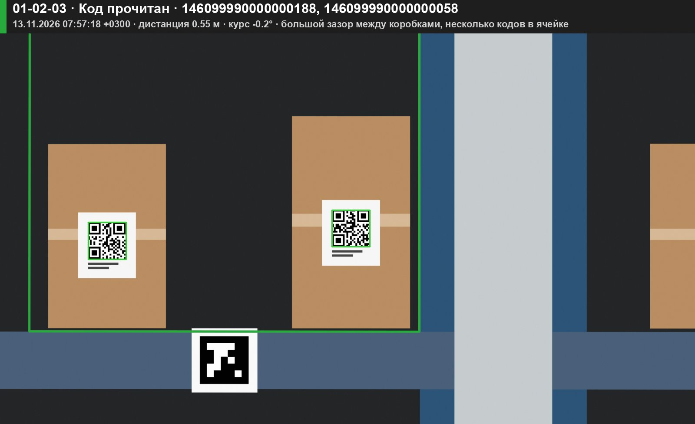
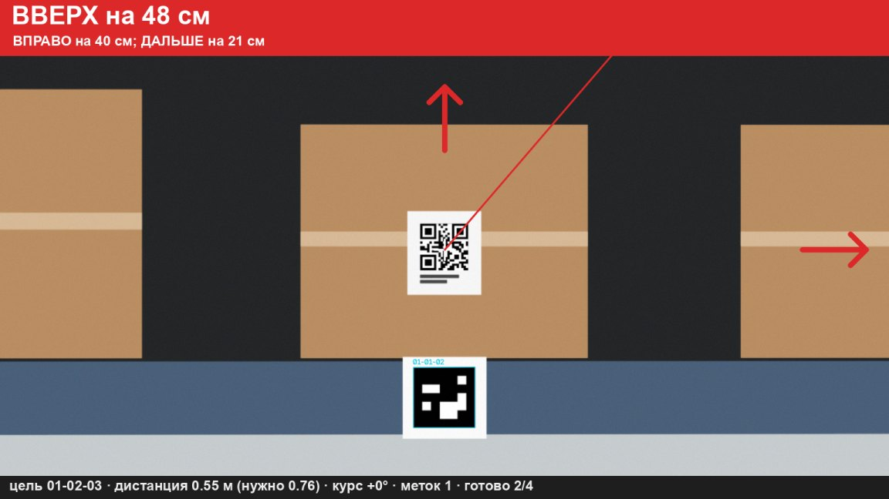
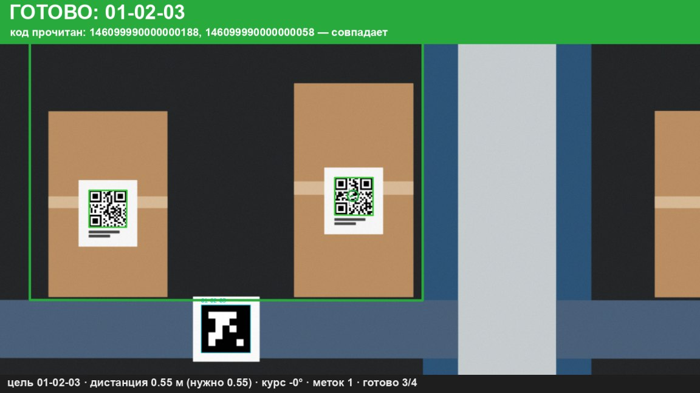

# ВВЕДЕНИЕ

Записка объясняет, как устроен стенд RackScan и почему приняты именно такие решения: какие метки и где размещаются, как по ним вычисляется положение камеры, с какого расстояния читается код, как принимается решение о занятости ячейки и как из ошибки положения получаются команды оператору. Расчёты доведены до чисел для выбранной камеры; там, где число получено только на синтетической сцене, это оговорено.

Стенд — первая очередь проекта автономной инвентаризации. Дрон из первой очереди исключён намеренно: две задачи — «увидеть и прочитать» и «долететь и удержаться» — разделены, чтобы первую можно было отладить за недели, а не за месяцы. Всё, что стенд сообщает человеку, он готов сообщать автопилоту.

# 1 Назначение и область применения

Стенд определяет адрес ячейки стеллажа, её занятость, читает код грузового места, ведёт оператора к положению уверенного чтения, сохраняет фотографию и сверяет результат с учётной системой склада. Область применения первой очереди — лабораторный макет и демонстрация; второй очереди — пилотный участок действующего склада с тем же программным обеспечением на дроне или тележке с мачтой.

# 2 Опора на литературу проекта

Решения стенда опираются на источники, собранные в проекте (каталог `books`). Ниже указано, что именно взято и что прочитано.

T[lit]: Использование источников

| Источник | Что взято | Что прочитано для этой работы |
|---|---|---|
| Lin, Chang, Huang. Drones, 2024 (статья A) | Разделение обнаружения и декодирования; «направляющий механизм» — движение в сторону необследованных кандидатов; учёт каждой метки один раз; методика «10 прогонов, доля найденного и число шагов» | Перечитаны разделы 2.2, 4 (4.1–4.5), 5.3 и 6 |
| Gao, Zhang. Introduction to Visual SLAM (книга) | Модель камеры (ф. 4.5–4.12), повороты (гл. 2), PnP как минимизация ошибки репроекции (ф. 6.36) | Использованы разделы, прочитанные ранее полностью: 2.3–2.4, 4.1, 6.7 |
| Zhang и др. Scientific Reports, 2025 (статья V) | Методика экспериментов: несколько базовых вариантов, две метрики, среднее по 10 прогонам | Не перечитывалась; использован конспект проекта |
| Chen и др. IEEE Access, 2021 (статья M) | К стенду не относится (карта препятствий); учтена в проработке носителя | Не перечитывалась |

Отличие от статьи A. Авторы статьи наклеивали на коробки метки AprilTag размером 6,7 см и считали задачу решённой, когда метка обнаружена. В стенде на коробках — настоящие коды (QR, Code 128), а метки ArUco служат только адресом ячейки и опорой для измерений. Обучение с подкреплением для выбора ракурса заменено расчётом: положение этикетки на фасаде известно из геометрии, и нужная поза камеры вычисляется напрямую. Это предсказуемо и проверяемо, что важно для будущего полёта.

# 3 Структура стенда

<figure>
<svg viewBox="0 0 760 330" width="100%" xmlns="http://www.w3.org/2000/svg" font-family="Arial, sans-serif" font-size="11.5">
  <defs><marker id="a1" markerWidth="8" markerHeight="8" refX="7" refY="4" orient="auto"><path d="M0,0 L8,4 L0,8 z"/></marker></defs>
  <g fill="none" stroke="#000" stroke-width="1.1">
    <rect x="10" y="20" width="110" height="46"/><rect x="150" y="20" width="110" height="46"/>
    <rect x="290" y="20" width="120" height="46"/><rect x="440" y="20" width="120" height="46"/>
    <rect x="590" y="20" width="160" height="46"/>
    <rect x="290" y="110" width="120" height="46"/><rect x="440" y="110" width="120" height="46"/>
    <rect x="590" y="110" width="160" height="46"/>
    <rect x="590" y="200" width="160" height="46"/><rect x="440" y="200" width="120" height="46"/>
    <rect x="290" y="200" width="120" height="46"/><rect x="150" y="200" width="110" height="46"/>
    <rect x="10" y="110" width="110" height="46"/><rect x="590" y="270" width="160" height="46"/>
    <line x1="120" y1="43" x2="150" y2="43" marker-end="url(#a1)"/><line x1="260" y1="43" x2="290" y2="43" marker-end="url(#a1)"/>
    <line x1="410" y1="43" x2="440" y2="43" marker-end="url(#a1)"/><line x1="560" y1="43" x2="590" y2="43" marker-end="url(#a1)"/>
    <line x1="350" y1="66" x2="350" y2="110" marker-end="url(#a1)"/><line x1="500" y1="66" x2="500" y2="110" marker-end="url(#a1)"/>
    <line x1="410" y1="133" x2="440" y2="133" marker-end="url(#a1)"/><line x1="560" y1="133" x2="590" y2="133" marker-end="url(#a1)"/>
    <line x1="670" y1="66" x2="670" y2="110" marker-end="url(#a1)"/><line x1="670" y1="156" x2="670" y2="200" marker-end="url(#a1)"/>
    <line x1="590" y1="223" x2="560" y2="223" marker-end="url(#a1)"/><line x1="440" y1="223" x2="410" y2="223" marker-end="url(#a1)"/>
    <line x1="290" y1="223" x2="260" y2="223" marker-end="url(#a1)"/>
    <line x1="65" y1="110" x2="65" y2="66" marker-end="url(#a1)" stroke-dasharray="4 3"/>
    <line x1="670" y1="246" x2="670" y2="270" marker-end="url(#a1)"/>
    <polyline points="120,133 135,133 135,180 620,180 620,156" marker-end="url(#a1)" stroke-dasharray="4 3"/>
  </g>
  <g text-anchor="middle">
    <text x="65" y="40">Источник кадров</text><text x="65" y="55" font-size="10">sources.py</text>
    <text x="205" y="40">Метки ArUco</text><text x="205" y="55" font-size="10">markers.py</text>
    <text x="350" y="40">Поза камеры (PnP)</text><text x="350" y="55" font-size="10">pose.py</text>
    <text x="500" y="40">Выпрямление ячейки</text><text x="500" y="55" font-size="10">pose.rectify</text>
    <text x="670" y="40">Занятость и зазоры</text><text x="670" y="55" font-size="10">occupancy.py</text>
    <text x="350" y="130">Наведение</text><text x="350" y="145" font-size="10">guidance.py</text>
    <text x="500" y="130">Коды и кандидаты</text><text x="500" y="145" font-size="10">codes.py</text>
    <text x="670" y="130">Автомат сканирования</text><text x="670" y="145" font-size="10">scanner.py</text>
    <text x="670" y="220">Фото и журнал</text><text x="670" y="235" font-size="10">evidence.py</text>
    <text x="500" y="220">Сверка с учётом</text><text x="500" y="235" font-size="10">wms/reconcile.py</text>
    <text x="350" y="220">Эмулятор / 1С</text><text x="350" y="235" font-size="10">wms/emulator, onec</text>
    <text x="205" y="220">Ведомость</text><text x="205" y="235" font-size="10">HTML, CSV</text>
    <text x="65" y="130">Датчики ESP32</text><text x="65" y="145" font-size="10">sensors.py</text>
    <text x="670" y="290">Пульт оператора</text><text x="670" y="305" font-size="10">server.py, web/</text>
  </g>
</svg>
</figure>

F[arch]: Обработка кадра: модули программы и потоки данных

Каждый кадр предпросмотра проходит один и тот же путь (рисунок {F:arch}). Источник кадров заменяем: камера Raspberry Pi, USB-камера, папка с записанными кадрами или синтетическая сцена. Автомат сканирования — единственный модуль с памятью между кадрами; остальные — функции от кадра. Благодаря этому ядро проверяется автотестами на ПК без оборудования.

Вычисления выполняются на борту вычислителя. По сети передаются только готовое изображение с пометками и результаты. Это следует выводу статьи A, авторы которой вынесли вычисления на ноутбук по беспроводной сети и получили зависимость полёта от связи; на складе с металлическими стеллажами такая зависимость недопустима.

# 4 Оптика: с какого расстояния читается код

## 4.1 Формула

По модели камеры-обскуры точка на расстоянии Z вдоль оптической оси и X поперёк неё проецируется в пиксель

u = fx · X / Z + cx, &nbsp;&nbsp;&nbsp; (1)

где fx — фокусное расстояние в пикселях (книга, ф. 4.5). Отсюда один миллиметр на фасаде, удалённом на d метров, занимает fx / (1000·d) пикселей, а модуль кода шириной Xм миллиметров —

p = fx · Xм / (1000 · d) пикселей. &nbsp;&nbsp;&nbsp; (2)

Декодеру нужно не менее pмин пикселей на модуль. Принято pмин = 3: предел декодера около 2, запас взят на расфокусировку и шум. Наибольшая дистанция чтения:

dмакс = fx · Xм / (1000 · pмин). &nbsp;&nbsp;&nbsp; (3)

Фокусное расстояние в пикселях выражается через паспортный горизонтальный угол поля зрения α и ширину кадра W: fx = W / (2·tg(α/2)). Для Camera Module 3 (α = 66°): в полном кадре W = 4608 и fx = 3548; в кадре предпросмотра W = 1536 и fx = 1183.

## 4.2 Две дистанции

Ячейка должна целиком помещаться в кадр с полями, чтобы оценить занятость и видеть соседние метки. Наименьшая дистанция, с которой объект шириной w и высотой h виден с полями m (доля кадра с каждой стороны):

dобз = max( w / (1 − 2m) · fx / W, &nbsp; h / (1 − 2m) · fy / H ). &nbsp;&nbsp;&nbsp; (4)

Получаются две рабочие дистанции. Дистанция обзора dобз ограничена снизу формулой (4). Дистанция чтения ограничена сверху формулой (3). Если dмакс ≥ dобз, код читается уже с дистанции обзора. Если нет, нужен подход к этикетке — именно тот «подлёт», который задан постановкой задачи.

T[dist]: Рабочие дистанции для Camera Module 3 (поля 15 %)

| Объект | Ячейка, м | Модуль кода, мм | d обзора, м | d чтения предельная, м | Вывод |
|---|---|---|---|---|---|
| Макет: коробка, QR 40 мм (версия 1) | 0,40 × 0,40 | 1,9 | 0,76 | 2,25 | Читается с обзора; подход до 0,55 м делается ради качества фотографии |
| Макет: QR 30 мм (версия 2) | 0,40 × 0,40 | 1,2 | 0,76 | 1,42 | Читается с обзора |
| Паллета: GS1-128, модуль 1,0 мм | 0,90 × 1,50 | 1,0 | 2,87 | 1,18 | Нужен подход примерно до 1 м |
| Паллета: GS1-128, модуль 0,5 мм | 0,90 × 1,50 | 0,5 | 2,87 | 0,59 | Подход до 0,5 м либо камера с объективом 16 мм (до 1,7 м) |

Вывод для постановки задачи: «подлёт на расстояние около метра» верен для логистических этикеток с модулем около 1 мм. Для модуля 0,5 мм метра недостаточно при этой камере. Первое, что нужно измерить на реальном складе, — ширину модуля на реальных этикетках; от неё зависят и камера, и дистанция. Для кода GS1-128 с SSCC ширина модуля равна длине штриховой части, делённой на 156.

Программа выбирает дистанцию чтения как меньшее из 0,8·dмакс и заданного потолка (0,55 м для макета, 1,0 м для паллет) и не подходит ближе дистанции, с которой адресная метка ячейки ещё видна целиком, — иначе пропадает опора для измерения положения.

## 4.3 Смаз

При движении камеры вдоль фасада со скоростью v за время выдержки τ изображение смещается на v·τ. Отношение смаза к модулю не зависит ни от камеры, ни от расстояния:

β = v · τ / Xм ≤ 0,5. &nbsp;&nbsp;&nbsp; (5)

Для модуля 1,9 мм и скорости 0,3 м/с выдержка должна быть не длиннее 3,2 мс. На штативе это требование не действует, но в программе уже есть проверка неподвижности: полный кадр снимается, только когда положение камеры между кадрами изменилось меньше чем на 2 см, а угловая скорость по гироскопу ниже 8 °/с.

# 5 Адресные метки

## 5.1 Выбор метки

Метка ArUco — квадрат из n × n чёрных и белых модулей в чёрной рамке. Она даёт сразу две вещи: номер, по которому в таблице находится адрес ячейки, и четыре угла с известными координатами — опору для измерений. Принят словарь `DICT_5X5_1000`: 1000 номеров хватает на стенд и пилотный участок, а расстояние Хэмминга между кодами позволяет отбрасывать ложные срабатывания. Сторона метки 50 мм; модуль равен 50 / 7 = 7,1 мм, и по формуле (3) при pмин = 4 метка обнаруживается в кадре предпросмотра с 2,1 м.

Номер метки вычисляется из адреса: (стеллаж − 1)·100 + (ярус − 1)·10 + (место − 1). Таблица «номер → адрес» хранится в файле модели стенда, поэтому схему нумерации можно заменить без изменения программы.

## 5.2 Размещение

Карточка с меткой крепится на передней кромке полки под ячейкой, по центру её ширины. Так размещают адресные этикетки на балках настоящих стеллажей; эксперимент проекта (журнал, LOC-08) показал, что плотные адресные ориентиры дают ошибку положения 6–8 см против 30–74 см при метках только на торцах ряда.

На реальном складе адресная этикетка ячейки уже есть — обычно это штрихкод или QR. Читать её вместо метки ArUco можно, но у этикетки хуже дальность обнаружения и неизвестен размер. Практичный путь для пилота — карточка, на которой рядом напечатаны штатный адресный код склада и метка ArUco.

# 6 Положение камеры относительно фасада

## 6.1 Системы координат

Система фасада: ось X — вправо, если смотреть на стеллаж из прохода; Y — вверх; Z — из стеллажа в проход. Начало — левый нижний угол первого стеллажа ряда; плоскость Z = 0 — передние кромки полок. Стеллажи одного ряда стоят в линию и имеют общую систему, поэтому наведение не обрывается на стыке стеллажей. Система камеры — как в OpenCV: x вправо, y вниз, z вперёд.

Положение камеры описывается шестью числами: координаты (x, y, z) центра камеры в системе фасада, где z — дистанция до фасада, и три угла — курс ψ (положителен, когда камера смотрит правее нормали к фасаду), тангаж θ (вверх) и крен φ.

## 6.2 Решение

Все метки ряда, видимые в кадре, решаются совместно. Известны координаты углов Pi в системе фасада и их пиксели ui; ищется преобразование T из системы фасада в систему камеры, минимизирующее ошибку репроекции (книга, ф. 6.36):

T* = arg min ½ Σ ‖ ui − π(K, T·Pi) ‖². &nbsp;&nbsp;&nbsp; (6)

Начальное приближение даёт аналитический метод для плоских точек (IPPE), уточнение — метод Левенберга — Марквардта. Положение камеры: c = −Rᵀ·t; курс: ψ = arctg( ax / (−az) ), где a — третья строка матрицы поворота R, то есть оптическая ось камеры в системе фасада.

Совместное решение по нескольким меткам снимает главную слабость одиночной метки. У плоского квадрата два почти равноценных решения, отличающихся знаком наклона; в эксперименте проекта (LEARN-07) одиночная этикетка давала ошибку ориентации до 2,4°. Когда в кадре одна метка, программа выбирает решение, ближайшее к предыдущему кадру, и помечает результат признаком «поза по одной метке».

## 6.3 Точность

Метки ищутся на уменьшенной копии кадра (ширина 960 пикселей), после чего углы уточняются до долей пикселя на исходном кадре. Такой порядок оказался и быстрее, и точнее поиска в полном размере.

T[acc]: Ошибка оценки положения на синтетической сцене (40 случайных положений, дистанция 0,45–1,8 м, курс до ±20°)

| Способ поиска меток | Время, мс | Средняя ошибка x / y / z, мм | Наибольшая ошибка x / y / z, мм | Курс: средняя / наибольшая, ° |
|---|---|---|---|---|
| В полном размере 1536 × 864 | 51 | 1,6 / 2,8 / 0,6 | 17 / 41 / 3 | 0,08 / 1,0 |
| Копия 960 пикселей + уточнение углов | 27 | 0,8 / 1,2 / 0,4 | 4 / 8 / 2 | 0,04 / 0,3 |

Числа получены на ПК разработчика и на синтетических кадрах без бликов и дисторсии. На Raspberry Pi 5 время будет в несколько раз больше, а на реальной камере точность зависит от калибровки. Проверка на оборудовании — пункт 5.2 программы испытаний.

# 7 Занятость ячейки и зазоры

Зная положение камеры, программа «выпрямляет» проём ячейки: четыре угла проёма проецируются в кадр, и по ним строится фронтальный вид с известным масштабом (0,6 пикселя на миллиметр). В этом виде ширина любого участка сразу измеряется в миллиметрах.

Решение о занятости принимается по признакам в порядке убывания надёжности.

1. В ячейке прочитан или найден код — занято.
2. Отличие от эталона пустой ячейки. Эталоны снимаются один раз при настройке стенда (`calibrate-empty`); сравнение выдерживает изменение освещённости на 20 %.
3. Дальномер. Если камера наведена на центр ячейки и до препятствия ближе половины глубины ячейки — занято; дальше 0,8 глубины — видна задняя стенка, пусто.
4. Без эталона — цвет картона и белой наклейки. Это грубая оценка: коробку другого цвета она не увидит. Поэтому без эталона ответ «пусто» принимается с низкой уверенностью, а при близком препятствии по дальномеру заменяется на «занято».

Если признаки спорят (эталон говорит «пусто», дальномер — «близко»), исход — «занятость не определена», и ячейка уходит на ручную проверку с фотографией. Ложное «пусто» хуже честного «не знаю»: оно превращается в ложную недостачу.

Зазоры. В нижних 70 % проёма для каждого столбца считается доля «не фона»; столбцы, заполненные больше чем на 45 %, образуют занятые участки. Свободный промежуток между соседними участками шире 90 мм даёт признак «большой зазор между коробками»; свободная доля ширины больше 65 % — признак «ячейка заполнена слабо». Пороги настраиваются.

# 8 Поиск и чтение кода

Обнаружение и декодирование разделены, как в статье A. Декодер zxing-cpp читает QR Code, Data Matrix, Code 128 и другие символики. Отдельно ищутся кандидаты — места, похожие на этикетку: светлое пятно ожидаемого размера с мелким контрастным рисунком внутри. Ожидаемый размер в пикселях известен из положения камеры, что позволяет отрезать от пятна узкие светлые полосы скотча.

Кандидат без чтения — не «пусто», а причина подойти ближе. Если после трёх съёмок с уменьшением дистанции на 15 % код не прочитан, исход — «ошибка чтения». Если коробка есть, а кандидатов нет ни издалека, ни вблизи, — «нет этикетки».

При разработке найдены и устранены два источника ложных срабатываний. Декодер в режиме «сообщать о нечитаемых кодах» выдаёт ложные «ошибки» линейных кодов на любой полосатой фактуре и ложные Data Matrix на шуме; такие сообщения учитываются только для QR, у которого три поисковых узора случайно не складываются. Кроме того, кандидат считается этикеткой, только если замечен не менее двух раз.

Содержимое кода разбирается по правилам GS1: идентификатор применения (00) — SSCC из 18 цифр с проверкой контрольной цифры, (01) — GTIN. Поддержаны запись в скобках, сплошная запись с разделителями и «голые» 18 или 20 цифр.

# 9 Наведение

## 9.1 Ошибка положения и команды

Цель — поставить камеру напротив точки (X*, Y*) фасада на дистанции d* по нормали к фасаду. Ошибки:

ex = X* − x, &nbsp; ey = Y* − y, &nbsp; ez = z − d*, &nbsp; eψ = ψ. &nbsp;&nbsp;&nbsp; (7)

Каждая ошибка, превышающая допуск, превращается в команду: ex > 0 — «ВПРАВО», ey > 0 — «ВВЕРХ», ez > 0 — «БЛИЖЕ», eψ > 0 — «ПОВЕРНИТЕ ВЛЕВО», с величиной в сантиметрах или градусах. Команды упорядочены по отношению ошибки к допуску; первая выводится крупно.

T[tol]: Допуски наведения

| Этап | По фасаду, см | По дистанции, см | Курс, ° |
|---|---|---|---|
| Выход к ячейке (обзор) | ±5 | ±12 | ±7 |
| Подход к этикетке (чтение) | ±2,5 | ±6 | ±5 |

Когда все ошибки в допуске, состояние становится жёлтым («ДЕРЖИТЕ РОВНО»); после трёх неподвижных кадров снимается полный кадр.

## 9.2 Уставка для дрона

Та же ошибка переводится в систему носителя, у которого «вперёд» — вдоль оптической оси:

вперёд = ex·sin ψ + ez·cos ψ, &nbsp; вправо = ex·cos ψ − ez·sin ψ, &nbsp; вверх = ey, &nbsp; поворот = −ψ. &nbsp;&nbsp;&nbsp; (8)

и подаётся в пропорциональный закон с насыщением v = sat(Kp·e, vмакс) при Kp = 0,8 1/с и vмакс = 0,3 м/с. Уставка показывается на пульте и пишется в журнал, но на стенде не исполняется.

Закон проверен в замкнутом цикле: имитатор носителя на каждом шаге смещает виртуальную камеру на 70 % показанной ошибки с добавлением шума 4 мм. Учебный склад из 18 ячеек обходится за 278 шагов, в среднем 15 шагов на ячейку; все исходы совпали с заложенными. Это проверка логики, а не динамики полёта: инерция, запаздывание и ветер от винтов в ней не участвуют.

# 10 Автомат сканирования

<figure>
<svg viewBox="0 0 760 250" width="100%" xmlns="http://www.w3.org/2000/svg" font-family="Arial, sans-serif" font-size="11.5">
  <defs><marker id="a2" markerWidth="8" markerHeight="8" refX="7" refY="4" orient="auto"><path d="M0,0 L8,4 L0,8 z"/></marker></defs>
  <g fill="none" stroke="#000" stroke-width="1.1">
    <rect x="10" y="40" width="100" height="50" rx="8"/><rect x="150" y="40" width="110" height="50" rx="8"/>
    <rect x="300" y="40" width="110" height="50" rx="8"/><rect x="450" y="40" width="120" height="50" rx="8"/>
    <rect x="610" y="40" width="130" height="50" rx="8"/><rect x="450" y="170" width="120" height="50" rx="8"/>
    <rect x="150" y="170" width="110" height="50" rx="8"/>
    <line x1="110" y1="65" x2="150" y2="65" marker-end="url(#a2)"/><line x1="260" y1="65" x2="300" y2="65" marker-end="url(#a2)"/>
    <line x1="410" y1="65" x2="450" y2="65" marker-end="url(#a2)"/><line x1="570" y1="65" x2="610" y2="65" marker-end="url(#a2)"/>
    <polyline points="675,90 675,195 570,195" marker-end="url(#a2)"/>
    <polyline points="355,90 355,195 450,195" marker-end="url(#a2)"/>
    <line x1="450" y1="195" x2="260" y2="195" marker-end="url(#a2)" stroke-dasharray="1 0"/>
    <polyline points="640,40 640,18 510,18 510,40" marker-end="url(#a2)" stroke-dasharray="4 3"/>
    <polyline points="150,205 60,205 60,90" marker-end="url(#a2)"/>
  </g>
  <g text-anchor="middle">
    <text x="60" y="62" font-weight="bold">ПОИСК</text><text x="60" y="78" font-size="10">меток нет</text>
    <text x="205" y="62" font-weight="bold">ВЫХОД</text><text x="205" y="78" font-size="10">к ячейке</text>
    <text x="355" y="62" font-weight="bold">ОСМОТР</text><text x="355" y="78" font-size="10">4 кадра</text>
    <text x="510" y="62" font-weight="bold">ПОДХОД</text><text x="510" y="78" font-size="10">к этикетке</text>
    <text x="675" y="62" font-weight="bold">СЪЁМКА</text><text x="675" y="78" font-size="10">полный кадр, чтение</text>
    <text x="510" y="192" font-weight="bold">ЗАПИСЬ</text><text x="510" y="208" font-size="10">фото, журнал, WMS</text>
    <text x="205" y="192" font-weight="bold">Следующая</text><text x="205" y="208" font-size="10">ячейка задания</text>
  </g>
  <g font-size="10.5">
    <text x="114" y="58">метки</text><text x="264" y="58">в допуске</text><text x="414" y="58">занято</text><text x="574" y="58">ровно</text>
    <text x="362" y="140">пусто</text><text x="682" y="140">прочитано либо попытки исчерпаны</text>
    <text x="520" y="14">не прочитано: ближе на 15 %</text>
  </g>
</svg>
</figure>

F[fsm]: Этапы обработки одной ячейки

T[outcomes]: Исходы сканирования ячейки и вердикты сверки

| Исход сканирования | Условие | Вердикт сверки |
|---|---|---|
| Код прочитан | Прочитан хотя бы один код | Совпадает; излишек (по учёту пусто); пересортица (по учёту другое); частичное совпадение |
| Пусто | Занятость «нет», кандидатов нет | Совпадает (по учёту пусто); недостача |
| Нет этикетки | Занято, кандидатов нет и вблизи | Ручная проверка |
| Ошибка чтения | Этикетка найдена, код не декодирован за три съёмки | Ручная проверка |
| Занятость не определена | Признаки спорят или недостаточны | Ручная проверка |
| Пропущено | Команда оператора или истечение 120 с | Не сканировалась |

Если прочитанный код числится по учёту в другой ячейке, в примечание записывается её адрес. Точность учёта (IRA) считается как доля совпавших среди ячеек с определённым результатом; ячейки, ушедшие на ручную проверку, в неё не входят и показываются отдельной долей.

Порядок обхода — «змейкой»: ярусы снизу вверх, направление чередуется. Учётные остатки оператору до сканирования не показываются («слепой» пересчёт), чтобы ожидание не влияло на результат.

# 11 Фото-доказательства и журнал

На каждую ячейку сохраняются исходный кадр без пометок, кадр с пометками и подписью, паспорт результата в формате JSON. В паспорте: адрес, исход, коды, признаки, оценка занятости, положение камеры, показания датчиков, длительность, контрольная сумма SHA-256 исходного кадра. Журнал событий — текстовый файл, каждая строка которого — событие с порядковым номером и временем; файл только дополняется.

<figure></figure>

F[ev]: Фотография ячейки 01-02-03: два кода, признак большого зазора между коробками

# 12 Связь со складской системой

Программа обращается к складской системе через пять операций: список ячеек, остатки, создание задания на инвентаризацию, передача результата по ячейке, сличительная ведомость. Операции реализованы дважды: эмулятором на SQLite и клиентом HTTP-сервиса. Эмулятор доступен и как HTTP-сервис с адресами в стиле 1С (`/hs/rackscan/v1/…`), поэтому клиент проверяется против него по сети.

Таблицы эмулятора повторяют объекты, которыми оперирует система управления складом: ячейки, номенклатура, контейнеры с кодом SSCC, остатки по ячейкам, документ инвентаризации со строками.

Что известно о «1С:WMS Логистика. Управление складом». По документации с описанием функциональных характеристик (редакция 5): товар хранится в разрезе контейнеров — носителей с уникальным идентификатором; адрес ячейки составляется как «префикс кода + помещение + проезд + стеллаж + ярус + позиция»; инвентаризация оформляется документом «Плановая инвентаризация» и выполняется задачами на пересчёт — «Пересчет ячейки», «Пересчет контейнеров», «Пересчет состава контейнеров»; ячейка на время пересчёта не блокируется; инвентаризация паллетного хранения «на лету» ведётся пересчётом паллет в ячейках без пересчёта их состава. Последнее — в точности то, что делает стенд: считает контейнеры в ячейке и читает их коды. Штатный обмен (XML, веб-сервис) предназначен для связи с учётными системами 1С и для стенда не подходит.

Соответственно в программе: задание стенда отвечает задаче «Пересчет ячейки» документа «Плановая инвентаризация»; адрес WMS переводится в адрес стенда и обратно по настраиваемому шаблону (`AddressMap`); имена объектов конфигурации не зашиты, а находятся в базе командой `wms discover`, читающей состав стандартного интерфейса OData.

Что не сделано. С действующей базой обмен не испытывался: платформа 1С и конфигурация на машине разработчика не установлены, конфигурация распространяется по лицензии, а общедоступной демонстрационной базы нет — доступ выдаётся разработчиком по заявке. Имена справочников, регистров и документов в открытых источниках не приведены, поэтому в шаблоне HTTP-сервиса (каталог `onec`) они помечены как подлежащие замене.

Учебный склад. Открытые наборы данных об остатках по ячейкам реального склада целенаправленно не искались; эмулятор наполняется сгенерированным складом: 18 ячеек, 10 наименований, коды SSCC с тестовым префиксом. Остатки настоящего склада можно загрузить из файла CSV. В физическую сцену заложены расхождения всех видов: недостача, излишек, пересортица (две коробки поменяны местами), коробка без этикетки, повреждённая этикетка, две коробки с большим зазором.

# 13 Результаты проверки на синтетической сцене

T[res]: Самопроверка на учебном складе

| Показатель | Значение |
|---|---|
| Ячеек | 18 |
| Верно определённых исходов и вердиктов | 18 из 18 |
| Вердикты | совпадает — 12, недостача — 1, излишек — 1, пересортица — 2, ручная проверка — 2 |
| Шагов наведения всего / на ячейку | 278 / 15 |
| Автотестов | 78, все проходят |

<figure></figure>

F[live1]: Окно трансляции при выходе к ячейке: красное состояние, команда и стрелка

<figure></figure>

F[live2]: Окно трансляции после записи результата: зелёное состояние

Эти результаты подтверждают логику программы, но не её работу в реальных условиях. Синтетическая сцена не содержит бликов, теней, стретч-плёнки, перекрытий, смаза от дрожания рук; свет в ней равномерный, а пустая ячейка тёмная. Ожидаемо, что на оборудовании потребуются настройка порогов занятости и эталоны пустых ячеек.

# 14 Что не проверено и основные риски

T[risks]: Непроверенные решения

| Что | Почему риск | Как снимается |
|---|---|---|
| Код работы с камерой Raspberry Pi | Написан по документации Picamera2, не запускался | Программа испытаний, п. 5.1 |
| Прошивка ESP32 | Написана по документации на микросхемы, не запускалась | П. 5.3 |
| Поле зрения в режиме предпросмотра | У IMX708 часть режимов — с обрезкой кадра; ошибка даёт неверную дистанцию | Калибровка камеры, п. 5.2 |
| Занятость без эталона | Оценка по цвету картона | Эталоны пустых ячеек, дальномер, п. 5.5 |
| Чтение через плёнку и при бликах | На синтетике не моделируется | Опытная эксплуатация на макете с плёнкой |
| Обмен с 1С:WMS | Проверен только на эмуляторе | Этап 5 технического задания |
| Быстродействие на Raspberry Pi 5 | Измерено только на ПК | П. 5.6; запас — уменьшение кадра предпросмотра |

# СПИСОК ИСПОЛЬЗОВАННЫХ ИСТОЧНИКОВ

1. Lin H.-Y., Chang K.-L., Huang H.-Y. Development of UAV Navigation and Warehouse Inventory System Based on Reinforcement Learning // Drones. 2024. Vol. 8, no. 6. Art. 220.
2. Gao X., Zhang T. Introduction to Visual SLAM: From Theory to Practice. Singapore: Springer, 2021. 386 p.
3. Zhang S. et al. Real time task planning for order picking in intelligent logistics // Scientific Reports. 2025. Vol. 15. Art. 7331.
4. Chen S., Chen H., Chang C.-W., Wen C.-Y. Multilayer Mapping Kit for Autonomous UAV Navigation // IEEE Access. 2021. Vol. 9.
5. Garrido-Jurado S. et al. Automatic generation and detection of highly reliable fiducial markers under occlusion // Pattern Recognition. 2014. Vol. 47, no. 6. P. 2280–2292.
6. ГОСТ Р ИСО/МЭК 18004-2015. Информационные технологии. Технологии автоматической идентификации и сбора данных. Спецификация символики штрихового кода QR Code.
7. ГОСТ ISO/IEC 15417-2013. Информационные технологии. Технологии автоматической идентификации и сбора данных. Спецификация символики штрихового кода Code 128.
8. 1С:WMS Логистика. Управление складом, редакция 5: документация с описанием функциональных характеристик. URL: https://solutions.1c.ru/upload/reestr/f5f/al8t8jav183e26l19y96vdqlr4mzzn73/Dokumentatsiya-s-opisaniem-funktsionalnykh-kharakteristik.pdf (дата обращения: 13.11.2026).
9. Документы проекта INVENT_DRONE: «00. Разбор литературы», «02. Архитектура», «Изменение вектора развития», журнал экспериментов.

Статус стандартов 34.602-2020, Р 59792-2021, Р 2.105-2019, Р 2.610-2019, 2.702-2011 и Р ИСО/МЭК 18004-2015 проверен по справочным базам 13.11.2026; остальные стандарты указаны по памяти разработчика и подлежат сверке по фонду Росстандарта перед официальным использованием документов.
