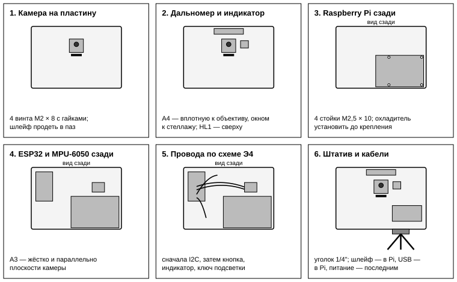
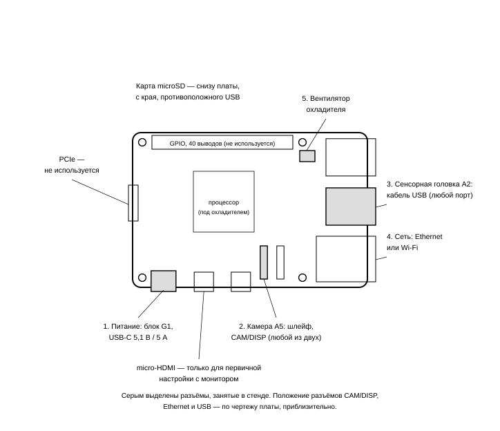
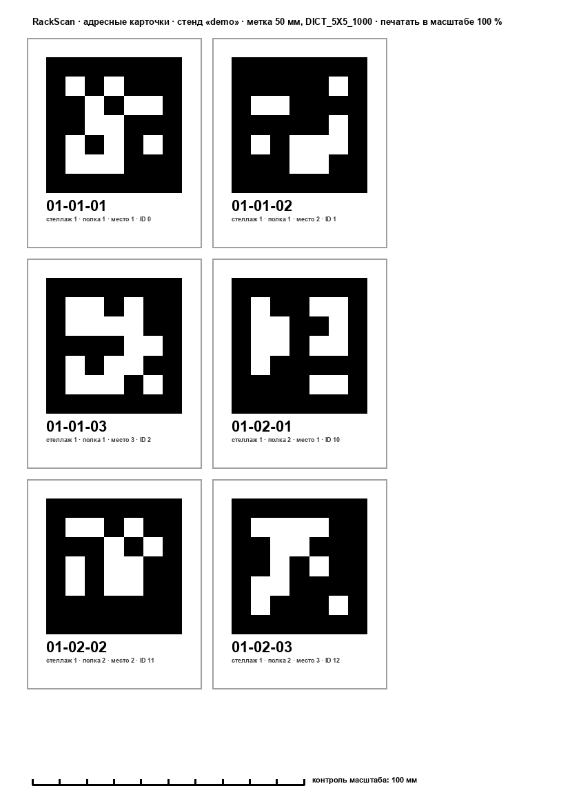
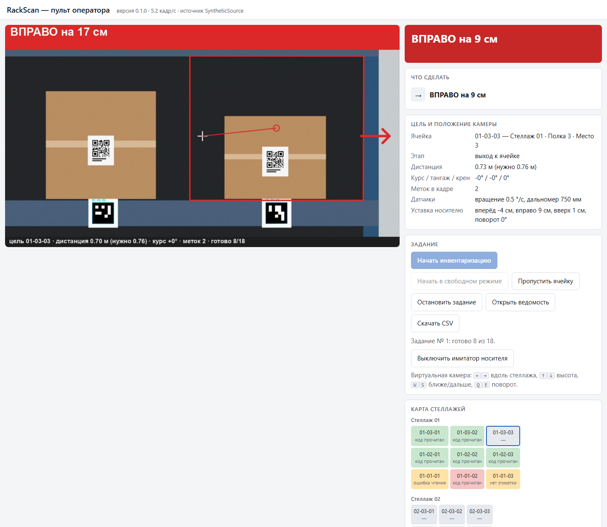
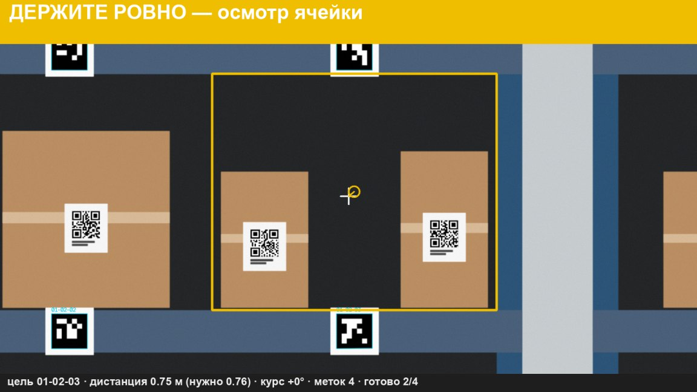

# ВВЕДЕНИЕ

Руководство ведёт от коробки с деталями до работающего стенда и дальше — к изменению программы. Оно объединяет четыре документа: руководство по эксплуатации изделия (разделы 1–3, 12, 13), руководство системного программиста (разделы 4–8, 10), руководство оператора (раздел 9) и руководство программиста (раздел 11).

Порядок чтения. Если оборудования ещё нет, начните с подраздела 11.1: программа запускается на обычном ПК с виртуальной камерой. Если оборудование есть, идите по разделам 2–9 подряд; каждый заканчивается проверкой, без которой не стоит переходить дальше.

Предупреждение о проверенности. Программа проверена на ПК на синтетической сцене. Части, работающие с оборудованием, — съёмка камерой Raspberry Pi, прошивка сенсорной головки, сценарий установки — написаны по документации производителей и на реальных платах не запускались. При первом включении ожидайте мелких несоответствий; раздел 12 перечисляет наиболее вероятные.

# 1 Назначение и состав стенда

Стенд определяет адрес ячейки стеллажа, её занятость, читает код на коробке, подсказывает оператору, как поставить камеру, сохраняет фотографию и сверяет результат с учётом склада. Подробное описание — в пояснительной записке RU.РСКН.00001-01 81 01.

Состав: вычислитель Raspberry Pi 5 с камерой; сенсорная головка (ESP32, инерциальный модуль, дальномер, индикатор, подсветка, кнопка); штатив; макет склада; ПК оператора. Перечень покупных изделий с ценами и схемы — в документе РСКН.467239.001 ВП, Э1, Э4.

T[spec]: Основные характеристики

| Характеристика | Значение |
|---|---|
| Напряжение питания | 5,1 В постоянного тока от блока USB-C PD 27 Вт |
| Потребляемая мощность | до 12 Вт с подсветкой (оценка) |
| Дистанция до фасада | 0,3–2,0 м |
| Дистанция обзора ячейки 0,4 × 0,4 м | 0,76 м |
| Дистанция чтения QR 40 мм | 0,55 м (предельная расчётная — 2,25 м) |
| Адресные метки | ArUco 5×5, сторона 50 мм |
| Читаемые коды | QR Code, Code 128 (GS1-128), Data Matrix, EAN-13 |
| Связь с оператором | Ethernet или Wi-Fi, веб-страница, порт 8080 |
| Условия работы | помещение, 10–35 °C, освещённость от 150 лк |

# 2 Меры безопасности

Все цепи стенда — сверхнизкого напряжения (не более 5,1 В). Собирайте и изменяйте схему только при отключённом питании: замыкание линии 5 В на вывод 3,3 В выводит из строя ESP32 и датчики. Датчики питаются только от 3,3 В.

Плата Raspberry Pi чувствительна к статическому электричеству: перед работой коснитесь заземлённого металла, держите плату за края. Шлейф камеры подключайте и отключайте только при выключенном питании.

Дальномер VL53L1X излучает в инфракрасном диапазоне и относится к лазерным изделиям класса 1 — безопасен при любых условиях использования, но разбирать модуль и смотреть в излучатель через оптику не следует. Подсветку направляйте на стеллаж, а не в лицо.

Штатив устанавливайте так, чтобы он не опрокинулся от натяжения кабелей; кабели закрепите на стойке штатива.

# 3 Сборка

## 3.1 Что понадобится

Отвёртка крестовая малая, пинцет, макетная плата или паяльник, двусторонний скотч или стойки М2,5, изделия по ведомости. Время сборки — 2–3 часа.

## 3.2 Пластина сенсорной головки

Все узлы стенда собираются на одной пластине 160 × 110 мм толщиной 3 мм (фанера, акрил или печатный пластик). Со стороны стеллажа на ней стоят камера, дальномер, индикатор, подсветка и кнопка; с обратной стороны — Raspberry Pi 5 на стойках, ESP32 и инерциальный модуль.

<figure></figure>

F[plate]: Пластина сенсорной головки: разметка отверстий и размещение узлов

T[holes]: Координаты отверстий пластины

| Отверстия | Назначение | Диаметр, мм | Координаты центров X; Y от левого нижнего угла, мм |
|---|---|---|---|
| 1–4 | Плата камеры A5 (винты М2) | 2,2 | 69,5; 65,6 · 90,5; 65,6 · 69,5; 78,1 · 90,5; 78,1 |
| 5–8 | Плата Raspberry Pi 5 (стойки М2,5) | 2,7 | 8; 6 · 66; 6 · 8; 55 · 66; 55 |
| 9, 10 | Уголок под штатив (винты М4) | 4,3 | 100; 6 · 130; 6 |
| — | Паз под шлейф камеры 18 × 3 | — | левый нижний угол 71; 57,5 |
| — | Ось объектива (для справки) | — | 80; 78 |
| — | Ось дальномера A4 (отверстия — по модулю) | — | 108; 78 |

Размеры плат Raspberry Pi 5 и Camera Module 3 взяты из чертежей производителя (RP-008347-DS-1 и RP-008153-DS-1): отверстия платы Pi 5 — Ø2,7 мм по сетке 58 × 49 мм; отверстия камеры — Ø2,2 мм по сетке 21 × 12,5 мм; ось объектива — в 12,5 мм от бокового края платы и в 14,4 мм от нижнего. Платы ESP32, GY-521, VL53L1X и линейка WS2812B у разных изготовителей имеют разные размеры: их отверстия размечают по самому модулю либо крепят модули двусторонним скотчем на вспененной основе.

Правила размещения, от которых зависит точность:

1. Дальномер A4 ставится вплотную к объективу — на чертеже в 28 мм от его оси, не дальше 30 мм, — окном в ту же сторону. Его луч должен идти параллельно оптической оси камеры: показание сравнивается с дистанцией, вычисленной по кадру.
2. Инерциальный модуль A3 крепится жёстко, плоскостью параллельно пластине; при вертикальной пластине и горизонтальной оптической оси он должен показывать постоянные углы. Провисание на проводах недопустимо.
3. Подсветка EL1 ставится ниже объектива, а не кольцом вокруг него: свет вдоль оптической оси даёт блик на этикетке прямо в центре кадра.
4. Индикатор HL1 должен быть виден оператору сбоку и сверху.
5. К двум отверстиям Ø4,3 крепится уголок с резьбой 1/4" под штатив.

## 3.3 Порядок сборки

<figure></figure>

F[steps]: Шесть шагов сборки

1. Камера. Приложите плату камеры объективом от пластины, совместите четыре отверстия, закрепите винтами М2 × 8 с гайками; под плату подложите шайбы или пластиковые втулки 1–2 мм, чтобы детали на обратной стороне платы не упирались в пластину. Шлейф продевается в паз под камерой на обратную сторону.
2. Дальномер и индикатор. Дальномер — справа от камеры, индикатор — вдоль верхнего края.
3. Raspberry Pi. До установки на пластину поставьте на плату активный охладитель: снимите плёнку с термопрокладок, совместите подпружиненные защёлки с отверстиями платы, подключите вентилятор к разъёму FAN. Затем вверните в пластину четыре стойки М2,5 × 10 и закрепите на них плату разъёмами USB и Ethernet к краю пластины.
4. ESP32 и инерциальный модуль — на обратной стороне, рядом с Raspberry Pi.
5. Провода — по схеме Э4 и таблице соединений документа РСКН.467239.001. Порядок: шина I2C (четыре провода к A3 и A4), кнопка, индикатор с резистором R1 и конденсатором C1, ключ подсветки VT1 с резисторами R2 и R3.
6. Уголок и штатив; затем кабели в порядке, показанном на рисунке {F:pi}: шлейф камеры, кабель USB сенсорной головки, сеть, и последним — питание.

## 3.4 Подключение к Raspberry Pi 5

<figure></figure>

F[pi]: Что и куда подключается на плате Raspberry Pi 5

T[piconn]: Подключения вычислителя

| № | Разъём платы | Что подключается | Примечание |
|---|---|---|---|
| 1 | USB-C | Блок питания G1, 5,1 В; 5 А | Подключать последним |
| 2 | CAM/DISP (любой из двух, 22 контакта, шаг 0,5 мм) | Камера A5, шлейф 22–15 контактов | Только при выключенном питании; программа находит камеру на любом из двух разъёмов |
| 3 | USB-A (любой) | Сенсорная головка A2, кабель USB с линиями данных | В системе — `/dev/ttyUSB0` или `/dev/ttyACM0` |
| 4 | Ethernet либо встроенный Wi-Fi | Локальная сеть с ПК оператора | Для первой настройки удобнее кабель |
| 5 | FAN (4 контакта) | Вентилятор активного охладителя | |
| — | microSD (снизу платы) | Карта памяти с системой | Готовится в разделе 4 |
| — | GPIO, micro-HDMI, PCIe | Не используются | micro-HDMI — только если настраивать с монитором |

Шлейф камеры. Поднимите фиксатор разъёма CAM/DISP, вставьте узкий конец шлейфа (22 контакта) до упора и опустите фиксатор; широкий конец (15 контактов) вставьте в разъём камеры. Сторону, которой должны быть обращены контакты, сверьте с рисунком в официальном руководстве к плате: шлейф, вставленный наоборот, плату не повредит, но камера не определится. Карту памяти пока не вставляйте.

Датчики к выводам GPIO платы Raspberry Pi напрямую не подключаются: все они работают через ESP32, поэтому гребёнка GPIO остаётся свободной.

## 3.5 Проверка сборки без питания

Мультиметром в режиме прозвонки убедитесь, что между линиями 5 В и GND, 3,3 В и GND, 5 В и 3,3 В нет короткого замыкания. Проверьте, что выводы VCC датчиков соединены с выводом 3V3 платы ESP32, а не с VIN.

# 4 Установка операционной системы

1. На ПК установите программу Raspberry Pi Imager с сайта raspberrypi.com.
2. Вставьте карту памяти. В программе выберите: устройство — Raspberry Pi 5; систему — Raspberry Pi OS (64-bit); накопитель — карту памяти.
3. Откройте настройки записи и задайте: имя узла `rackscan`; имя пользователя и пароль; сеть Wi-Fi и страну; на вкладке служб включите SSH с входом по паролю.
4. Запишите образ, вставьте карту в Raspberry Pi, подключите блок питания. Первая загрузка занимает 1–2 минуты.
5. С ПК подключитесь: `ssh пользователь@rackscan.local`. Если имя не находится, узнайте адрес платы в списке устройств маршрутизатора.
6. Обновите систему и проверьте камеру:

```
sudo apt update && sudo apt full-upgrade -y
rpicam-hello --list-cameras
rpicam-still -o test.jpg
```

Проверка: первая команда камеры выводит строку с `imx708` и перечнем режимов, вторая создаёт файл `test.jpg`. Если камера не найдена, см. раздел 12.

Руководство рассчитано на Raspberry Pi OS на основе Debian 12 (Bookworm) или Debian 13 (Trixie). На Bookworm системный OpenCV имеет версию 4.6; программа с ней совместима, но метки на ней обнаруживаются хуже, поэтому предпочтителен свежий выпуск системы.

# 5 Установка программы

1. Перенесите каталог `rackscan` на плату. С ПК, из корня репозитория:

```
git archive -o rackscan.zip HEAD rackscan
scp rackscan.zip пользователь@rackscan.local:~/
```

На плате:

```
unzip rackscan.zip && cd rackscan
bash deploy/install_pi.sh
```

2. Сценарий установки выполняет пять шагов: ставит системные пакеты (Picamera2, OpenCV, numpy, Flask, pyserial, шрифты); создаёт виртуальное окружение с доступом к системным пакетам; ставит в него декодер zxing-cpp; добавляет пользователя в группу `dialout` для доступа к последовательному порту; запускает самопроверку на синтетической сцене.

Не устанавливайте `opencv-python` и `numpy` через pip поверх системных: библиотека Picamera2 собрана под системный numpy и перестанет загружаться.

Проверка: сценарий заканчивается строкой «САМОПРОВЕРКА ПРОЙДЕНА». Самопроверка на Raspberry Pi 5 занимает несколько минут; её длительность запишите — это мера быстродействия.

3. После добавления в группу `dialout` выйдите из системы и войдите снова.

# 6 Прошивка сенсорной головки

1. Установите на ПК среду Arduino IDE 2. В настройках в поле дополнительных адресов менеджера плат укажите `https://espressif.github.io/arduino-esp32/package_esp32_index.json`, затем в менеджере плат установите пакет «esp32» от Espressif.
2. В менеджере библиотек установите «Adafruit NeoPixel» и «VL53L1X» (автор — Pololu).
3. Откройте файл `firmware/rackscan_sensor_head/rackscan_sensor_head.ino`. Выберите плату «ESP32 Dev Module» и порт.
4. Положите головку неподвижно и загрузите прошивку. Если загрузка останавливается на «Connecting…», удерживайте кнопку BOOT на плате до начала записи.
5. Откройте монитор порта на скорости 115200. Проверка: 50 раз в секунду идут строки вида

```
$RSI,15234,12,-8,1003,3,-2,1,-45,68,812,0*5A
```

Поля: время в миллисекундах; три ускорения в тысячных долях g (у лежащей горизонтально головки третье около 1000); три угловые скорости в сотых долях градуса в секунду (у неподвижной — единицы); крен и тангаж в сотых долях градуса; дальность в миллиметрах (−1 — нет цели); кнопка.

Первую секунду после включения головка должна быть неподвижна: в это время измеряется смещение нуля гироскопа.

6. Подключите головку кабелем USB к Raspberry Pi. На плате выполните `ls /dev/ttyUSB* /dev/ttyACM*` и запомните имя порта.

# 7 Макет склада: модель, метки, этикетки

## 7.1 Модель стенда

Измерьте стеллаж рулеткой и создайте файл модели. Пример для одного стеллажа с тремя полками по три ячейки шириной 400 мм:

```
.venv/bin/python -m rackscan gen-layout --out config/layout.json --racks 1 \
    --levels 3 --cells 3 --cell-w 400 --cell-h 340 --depth 300 \
    --beam 60 --upright 35 --first-shelf 150 --marker 50
```

T[lay]: Размеры, которые нужно измерить

| Параметр | Что это | Как измерять |
|---|---|---|
| `--cell-w` | Ширина ячейки | Ширина полки между стойками, делённая на число мест |
| `--cell-h` | Высота проёма | От настила полки до низа кромки следующей полки |
| `--beam` | Высота кромки полки | Высота передней кромки; если кромка уже карточки — высота карточки |
| `--first-shelf` | Высота настила нижней полки над полом | Рулеткой от пола |
| `--upright` | Ширина стойки | — |
| `--depth` | Глубина ячейки | От передней кромки до задней стенки или стены |
| `--gap` | Промежуток между стеллажами ряда | Для второго стеллажа в том же ряду |

Ошибка в размерах модели прямо переходит в ошибку наведения. Если полки расположены неравномерно, отредактируйте список `shelf_y_mm` в файле вручную: это высоты настила каждой полки над полом в миллиметрах.

## 7.2 Печать

```
.venv/bin/python -m rackscan wms init-demo
.venv/bin/python -m rackscan print -c config/pi.json --out out/print
```

Получаются два файла: `address_cards.pdf` — адресные карточки, по шесть на лист; `box_labels.pdf` — этикетки на коробки по учебному складу.

Печатайте в масштабе 100 % («фактический размер», без подгонки по размеру страницы). После печати измерьте контрольную линейку внизу листа: она должна быть равна 100 мм с отклонением не более 0,5 мм. Используйте матовую бумагу.

<figure></figure>

F[cards]: Лист адресных карточек

## 7.3 Наклейка

1. Адресную карточку клейте на переднюю кромку полки под ячейкой, по центру ширины ячейки, так, чтобы центр метки был на середине высоты кромки. Допуск — 3 мм. Карточка должна быть плоской: изгиб метки искажает измерения.
2. Не обрезайте белое поле вокруг метки: без него метка не обнаруживается.
3. Этикетку клейте на переднюю грань коробки, ближе к центру, без складок и не под скотч.
4. Расставьте коробки по ячейкам согласно остаткам: `python -m rackscan wms export --file out/stock.csv` выдаёт таблицу «адрес — код».

# 8 Настройка

## 8.1 Файл настроек

Скопируйте `config/pi.example.json` в `config/pi.json` и исправьте: путь к модели стенда, порт сенсорной головки, размеры этикетки. Полный перечень параметров — в приложении А.

Проверка узлов:

```
.venv/bin/python -m rackscan check -c config/pi.json
```

Команда по очереди проверяет камеру (кадр, число меток в кадре, время поиска меток, полный кадр), сенсорную головку и складскую систему и заканчивается итоговой строкой.

## 8.2 Калибровка камеры

Без калибровки программа берёт паспортные углы поля зрения. Этого достаточно для первого включения; для выполнения требований по точности камеру нужно откалибровать.

1. Напечатайте шахматную доску 10 × 7 клеток (9 × 6 внутренних углов) со стороной клетки 25 мм, наклейте на жёсткую плоскую основу.
2. Снимите 15–20 кадров в режиме предпросмотра так, чтобы доска побывала во всех частях кадра и под разными наклонами.
3. Выполните `python -m rackscan calibrate папка_с_кадрами --square 25` и укажите полученный файл в параметре `camera.calibration`.

Проверка: ошибка репроекции меньше 1 пикселя; при автофокусе калибровка действительна для той дистанции, на которой снималась, поэтому для измерений задайте постоянный фокус параметром `camera.lens_position` (диоптрии: 1 / дистанция в метрах; для 0,7 м — 1,4).

## 8.3 Эталоны пустых ячеек

Освободите стеллаж и выполните `python -m rackscan calibrate-empty -c config/pi.json`, медленно проведя камерой вдоль стеллажа с дистанции обзора. Для каждой ячейки сохраняется изображение пустого проёма. Эталоны нужно переснять после перестановки стеллажа, смены фона за ним или заметного изменения освещения.

Без эталонов занятость оценивается по цвету картона — этого хватает для коричневых коробок на тёмном фоне, но не для произвольных.

## 8.4 Автозапуск

Команды для установки службы выводит сценарий установки. После этого стенд запускается при включении питания; состояние — `systemctl status rackscan`, журнал службы — `journalctl -u rackscan -f`.

# 9 Работа оператора

## 9.1 Запуск

Включите питание стенда. На ПК в той же сети откройте в браузере `http://rackscan.local:8080`. Слева — трансляция с камеры с пометками, справа — пульт.

<figure></figure>

F[ui]: Пульт оператора

## 9.2 Цвета состояния

T[colors]: Что означает цвет

| Цвет | Значение | Что делать |
|---|---|---|
| Красный | Сканировать нельзя | Выполнить указание в верхней строке: сместить камеру или повернуть её на указанную величину |
| Жёлтый | Камера на месте, идёт осмотр или съёмка; либо результат записан с замечанием | Держать камеру неподвижно; если записано замечание — ничего не делать, стенд перейдёт дальше |
| Зелёный | Ячейка обработана, код прочитан или ячейка пуста | Ждать следующего указания |
| Серый | Задание не запущено | Нажать «Начать инвентаризацию» |

Цвет дублируется светодиодным индикатором на головке.

## 9.3 Порядок работы

1. Поставьте штатив на расстоянии около метра от стеллажа, объективом к нему. Нажмите «Начать инвентаризацию». Стенд получает задание от складской системы и называет первую ячейку.
2. Выполняйте указания. Главное указание — в красной полосе: например, «ВПРАВО на 35 см». Ниже — остальные. Смещения отсчитываются вдоль стеллажа и по высоте, «БЛИЖЕ» и «ДАЛЬШЕ» — к стеллажу и от него, «ПОВЕРНИТЕ ВЛЕВО» — поворот камеры вокруг вертикальной оси. Рамка на кадре показывает целевую ячейку, кружок — точку, которая должна оказаться в перекрестии.
3. Когда полоса станет жёлтой («ДЕРЖИТЕ РОВНО»), не двигайте камеру. Стенд осматривает ячейку (четыре кадра), затем ведёт к этикетке и снимает её.
4. Зелёная полоса «ГОТОВО» — результат записан. Через полторы секунды стенд называет следующую ячейку.
5. Если ячейку нельзя отсканировать (загорожена, недоступна), нажмите «Пропустить ячейку». Чтобы повторить ячейку, нажмите на неё на карте стеллажей.
6. После последней ячейки появляется «ЗАДАНИЕ ВЫПОЛНЕНО». Нажмите «Открыть ведомость».

<figure></figure>

F[assess]: Жёлтое состояние: осмотр ячейки

Свободный режим («Начать в свободном режиме») не задаёт порядок: целью становится та несканированная ячейка, которая ближе к центру кадра.

## 9.4 Исходы и что с ними делать

T[op-out]: Исходы сканирования

| Надпись | Что произошло | Действия оператора |
|---|---|---|
| Код прочитан | Код распознан, фотография сохранена | Нет |
| Пусто | Ячейка пуста, фотография сохранена | Нет |
| Нет этикетки | Коробка есть, этикетка не найдена | После обхода проверить коробку вручную: этикетка может быть сбоку или сзади |
| Ошибка чтения | Этикетка найдена, код не распознан за три попытки | Проверить этикетку: повреждена, загрязнена, под плёнкой с бликом |
| Занятость не определена | Признаки противоречивы | Осмотреть ячейку; при повторении — переснять эталоны |
| Пропущено | Команда оператора или истекло время (120 с) | Пересканировать, нажав на ячейку на карте |

Признаки: «большой зазор между коробками» — между коробками в ячейке свободно больше 90 мм; «ячейка заполнена слабо» — свободно больше 65 % ширины; «несколько кодов» — в ячейке прочитано больше одного кода.

## 9.5 Ведомость и фотографии

Сличительная ведомость содержит по строке на ячейку: что числится, что найдено, исход, результат сверки, признаки, примечание, ссылку на фотографию. Кнопка «Скачать CSV» сохраняет её в виде таблицы для Excel. Результаты сверки: «Совпадает», «Недостача», «Излишек», «Пересортица», «Частичное совпадение», «Ручная проверка», «Не сканировалась».

Фотографии и паспорта лежат на стенде в каталоге `data/evidence/<дата-время сеанса>/`. Скопировать сеанс на ПК: `scp -r пользователь@rackscan.local:~/rackscan/data/evidence/<сеанс> .`

# 10 Подключение складской системы

## 10.1 Эмулятор

По умолчанию стенд работает со встроенным эмулятором (файл `data/wms.sqlite`). Команды:

T[wmscmd]: Команды эмулятора

| Команда | Действие |
|---|---|
| `wms init-demo` | Создать учебный склад без расхождений |
| `wms export --file остатки.csv` | Выгрузить остатки |
| `wms import --file остатки.csv` | Загрузить остатки из файла «адрес;sscc;артикул;наименование;количество» |
| `wms report --file ведомость.html` | Сохранить ведомость последнего задания |
| `wms discover --url адрес_OData` | Найти в базе 1С объекты ячеек, контейнеров, остатков и инвентаризации |

Загрузка CSV — самый простой способ работать с данными настоящего склада: остатки по ячейкам выгружаются из учётной системы отчётом и загружаются в эмулятор.

Эмулятор доступен по сети как HTTP-сервис по адресу `http://rackscan.local:8080/wms/hs/rackscan/v1/` — тем же способом, каким будет доступна 1С.

## 10.2 1С:WMS Логистика. Управление складом

Что известно из официального описания решения (документация с описанием функциональных характеристик, редакция 5; разработчик — компания «СИТЕК»):

T[wmsfacts]: Как понятия стенда соотносятся с 1С:WMS

| В 1С:WMS | Что это | В стенде |
|---|---|---|
| Адрес ячейки: «префикс кода + помещение + проезд + стеллаж + ярус + позиция» | Идентификатор места хранения | Адрес «стеллаж–ярус–место»; перевод задаётся шаблоном `wms.address_template` |
| Контейнер | Любой носитель товара с уникальным идентификатором (паллета, коробка); товар хранится в разрезе контейнеров | Код SSCC на коробке |
| Документ «Плановая инвентаризация» | Оформление инвентаризации области склада, пустых ячеек, товара | Задание на инвентаризацию |
| Задача на пересчёт типа «Пересчет ячейки» | Пересчёт контейнеров и товаров в ячейке — по числу контейнеров либо по составу | Сканирование одной ячейки: сколько контейнеров и какие у них коды |
| Задача «Пересчет контейнеров» | Инвентаризация паллетного хранения «на лету», без пересчёта состава паллет | То, что стенд делает по существу |
| Ячейка на время пересчёта не блокируется | Склад не останавливается | Учётные остатки фиксируются при создании задания |
| Обмен: XML и веб-сервис с 1С:ERP, 1С:Управление торговлей, 1С:Комплексная автоматизация; HTTP-сервис с 1С:TMS | Штатная интеграция с учётной системой | Не используется: стенд — внешнее устройство, а не учётная система |

Чего в открытых источниках нет: имён объектов конфигурации (справочников, регистров, документов), описания программного интерфейса для внешних устройств и общедоступной демонстрационной базы. Демонстрационная база входит в комплект поставки; на сайте разработчика (wms.sitec-it.ru) доступ к демонстрации выдаётся по заявке. Поэтому подключение делается в три шага, первый из которых выполняет сам владелец базы.

Шаг 1. Получить базу. Оставить заявку на демо-доступ на сайте разработчика либо воспользоваться демонстрационной базой из поставки у внедренца. Попросить опубликовать базу на веб-сервере с включённым стандартным интерфейсом OData и выдать пользователя с правом чтения.

Шаг 2. Узнать имена объектов. Стенд сам читает состав базы и отбирает объекты, относящиеся к ячейкам, контейнерам, остаткам и инвентаризации:

```
.venv/bin/python -m rackscan wms discover \
    --url http://сервер/база/odata/standard.odata --file out/1c_objects.json
```

Команда печатает найденные сущности с их полями. По этому списку заполняются соответствие для чтения остатков (образец — `ODATA_MAPPING_EXAMPLE` в `rackscan/wms/onec.py`) и строки, помеченные «ЗАМЕНИТЬ», в шаблоне HTTP-сервиса `onec/РэкСканHTTPСервис.bsl`.

Шаг 3. Выбрать способ обмена.

Способ А — только чтение остатков через OData. Доработка 1С не нужна. Остатки загружаются в эмулятор стенда, сканирование и сверка идут на стенде, сличительная ведомость передаётся на склад файлом CSV; расхождения вносит в документ «Плановая инвентаризация» сотрудник склада.

Способ Б — HTTP-сервис в расширении конфигурации. Программист 1С добавляет расширение с сервисом `rackscan` по шаблону из каталога `onec` (запросы — в приложении Б). Тогда стенд получает задание и возвращает результаты напрямую. В настройках стенда:

```
"wms": {"backend": "onec_http",
        "url": "http://сервер/база/hs/rackscan/v1",
        "address_template": "A-01-{rack:02d}-{level:02d}-{pos:02d}",
        "user_env": "RACKSCAN_1C_USER", "password_env": "RACKSCAN_1C_PASSWORD"}
```

Шаблон адреса описывает, как адрес ячейки выглядит в WMS: постоянные части (префикс, помещение, проезд) пишутся как есть, стеллаж, ярус и позиция — полями. Ячейки WMS, не подходящие под шаблон, стенд не видит и в задание не включает. Имя и пароль пользователя 1С задаются переменными окружения в файле `/etc/rackscan.env` с правами доступа 600.

Проверка связи: `python -m rackscan check -c config/onec.json` — в третьем пункте должен быть ответ сервиса и число ячеек.

Состояние. Клиент, перевод адресов и поиск объектов проверены автотестами на эмуляторе и на поддельном сервере. С действующей базой 1С:WMS обмен не испытывался: платформа 1С и конфигурация на машине разработчика не установлены, конфигурация распространяется по лицензии. Первое подключение проводите на демонстрационной базе или копии рабочей.


## 11.1 Запуск на ПК без оборудования

Нужен Python 3.10 или новее. В каталоге `rackscan`:

```
python -m venv .venv
.venv/Scripts/python -m pip install -r requirements.txt
.venv/Scripts/python -m rackscan selftest
.venv/Scripts/python -m rackscan run
```

На Linux и macOS вместо `.venv/Scripts/python` пишется `.venv/bin/python`. После `run` откройте `http://localhost:8080`, нажмите «Начать инвентаризацию» и «Включить имитатор носителя»: виртуальная камера сама выполняет команды стенда. Вручную камерой управляют клавиши: стрелки — вдоль стеллажа и по высоте, W и S — ближе и дальше, Q и E — поворот.

## 11.2 Устройство программы

T[mods]: Модули

| Модуль | Назначение | Зависит от оборудования |
|---|---|---|
| `optics.py` | Модель камеры, расчёт дистанций | Нет |
| `layout.py` | Стеллажи, ячейки, адреса, карта меток | Нет |
| `markers.py` | Поиск и отрисовка меток ArUco, совместимость версий OpenCV | Нет |
| `pose.py` | Положение камеры по меткам, выпрямление ячейки | Нет |
| `occupancy.py` | Занятость и зазоры | Нет |
| `codes.py` | Чтение кодов, кандидаты, разбор GS1 | Нет |
| `guidance.py` | Команды и уставки | Нет |
| `scanner.py` | Автомат сканирования ячейки | Нет |
| `evidence.py`, `overlay.py` | Фотографии, журнал, пометки на кадре | Нет |
| `wms/` | Интерфейс склада, эмулятор, сверка, HTTP, клиент 1С | Нет |
| `server.py`, `web/index.html` | Сервер и пульт оператора | Нет |
| `sources.py` | Источники кадров | `PiCameraSource` — да |
| `sensors.py` | Протокол сенсорной головки | Последовательный порт |
| `synth.py`, `selftest.py` | Синтетическая сцена и самопроверка | Нет |

Правило: модуль, не зависящий от оборудования, обязан проверяться автотестом на ПК. Оборудование подключается через два узких места — источник кадров (`BaseSource`: методы `read` и `capture_still`) и складскую систему (`WmsBackend`: шесть методов).

## 11.3 Тесты

```
.venv/Scripts/python -W ignore -m unittest discover -s tests
```

T[tests]: Наборы тестов

| Файл | Что проверяет |
|---|---|
| `test_geometry.py` | Оптика, модель стенда, точность положения на синтетике, направления команд, сходимость наведения |
| `test_perception.py` | Разбор GS1 и SSCC, чтение трёх символик, отсутствие ложных срабатываний, занятость и зазоры, протокол датчиков, фотофиксация, печать в истинном размере |
| `test_wms.py` | Таблица вердиктов, эмулятор, CSV, HTTP-сервис с проверкой подлинности, клиент 1С, чтение OData |
| `test_system.py` | Замкнутый цикл по одной ячейке каждого вида исхода, автомат, сервер и пульт, настройки и командная строка |

Перед изменением закона наведения или порогов запускайте `selftest`: он обходит весь учебный склад и сравнивает исходы с заложенными.

## 11.4 Типовые доработки

Новая камера. Добавьте запись в `optics.CAMERA_PRESETS` (размер полного кадра и углы поля зрения) и укажите её в `camera.preset`. Проверьте расчёт дистанций: `python -m rackscan optics --camera имя`.

Другая этикетка. Измените раздел `label` настроек: размер символа, ширину модуля, размер наклейки. Для линейных кодов дистанция чтения определяется шириной модуля, см. пояснительную записку, раздел 4.

Новый источник кадров. Унаследуйте класс от `BaseSource`, реализуйте `read()` (кадр предпросмотра в порядке каналов B, G, R и время) и `capture_still()`; добавьте ветку в `make_source`.

Другая складская система. Реализуйте шесть методов `WmsBackend` (`cells`, `stock`, `create_task`, `post_result`, `report`, `close_task`) и добавьте ветку в `server.Runtime`. Правила сверки (`wms/reconcile.py`) общие.

Пороги и допуски. Все числа собраны в `ScanConfig` и `OccupancyConfig` и переопределяются в разделе `scan` настроек без правки кода; перечень — в приложении А.

Нейросетевой детектор. Место подключения — функция `codes.find_candidates`: она возвращает четырёхугольники кандидатов. Используйте модели с лицензиями, допускающими коммерческое применение (YOLOX, RT-DETR — Apache 2.0); пакет Ultralytics распространяется по AGPL-3.0 и для поставляемого продукта не подходит.

## 11.5 Перенос на дрон

Автомат сканирования не знает, кто двигает камеру. Для дрона нужен модуль-носитель, который берёт из снимка состояния поле `velocity` (скорости вперёд, вправо, вверх и скорость поворота в системе носителя) и передаёт его автопилоту, а в жёлтом состоянии удерживает положение. Состав такого модуля и условия безопасности — в документе «Носитель: эскизная проработка».

## 11.6 Сборка документации

```
.venv/Scripts/python docs/make_figures.py
.venv/Scripts/python docs/build_pdf.py
```

Первая команда заново получает рисунки прогоном программы на синтетической сцене, вторая собирает документы из каталога `docs` в PDF. Нужен браузер Chrome, Chromium или Edge.

# 12 Возможные неисправности

T[trouble]: Неисправности и способы устранения

| Проявление | Вероятная причина | Что делать |
|---|---|---|
| `rpicam-hello` не находит камеру | Шлейф вставлен не той стороной или не до упора; шлейф не для Pi 5 | Выключить питание, переставить шлейф; проверить, что узкий конец имеет 22 контакта |
| Ошибка импорта `picamera2` или `numpy` при запуске | В окружение через pip установлен другой numpy или OpenCV | Удалить окружение `.venv` и выполнить установку заново |
| На пульте «метки не видны» | Мало света; метка мала в кадре; белое поле обрезано; блик | Добавить свет, подойти ближе, перепечатать карточку на матовой бумаге |
| Дистанция на пульте отличается от измеренной на 10 % и больше | Метки напечатаны не в масштабе 100 %; режим предпросмотра обрезает кадр | Измерить метку линейкой; выполнить проверку поля зрения (программа испытаний, п. 5.2) и калибровку |
| Команда ведёт не к той ячейке | Ошибка в размерах модели; карточки перепутаны | Сверить `layout.json` с рулеткой; сверить адреса на карточках с подписями на кадре |
| Пустая ячейка определяется как занятая или наоборот | Нет эталонов; изменился фон или свет | Переснять эталоны (п. 8.3); подключить дальномер |
| Код виден, но не читается | Мало пикселей на модуль; блик; смаз | Уменьшить `d_label_cap_m`; сдвинуть подсветку; задать постоянный фокус |
| Жёлтое состояние не сменяется съёмкой | Камера дрожит: угловая скорость выше порога | Закрепить штатив; увеличить `gyro_limit_dps` |
| «Сенсорная головка не отвечает» | Неверный порт; нет прав; кабель без линий данных | `ls /dev/ttyUSB*`; перезайти после добавления в `dialout`; заменить кабель |
| Индикатор мерцает или светит не тем цветом | Уровень сигнала 3,3 В мал для линейки на 5 В | Преобразователь уровня либо питание линейки через диод |
| Плата перезагружается при включении подсветки | Просадка питания: блок слабее 5 А | Штатный блок 27 Вт либо отдельное питание подсветки |
| Трансляция реже 5 кадров в секунду | Не хватает быстродействия | `preview_size` 1152 × 648; проверить охлаждение (`vcgencmd measure_temp`) |

# 13 Техническое обслуживание и хранение

Перед каждым сеансом протирайте объектив и окно дальномера сухой безворсовой салфеткой; проверяйте, что карточки не отклеились и не загнулись. Раз в месяц проверяйте свободное место на карте памяти (`df -h`) и переносите старые сеансы фотографий на ПК; один сеанс на 18 ячеек занимает около 40 МБ. Перед отключением питания выполняйте `sudo shutdown -h now`: внезапное отключение может повредить файловую систему карты.

Хранить стенд следует в сухом помещении при температуре от 5 до 40 °C, плату и головку — в антистатической упаковке.

# ПРИЛОЖЕНИЕ А. Параметры настроек

T[cfg]: Основные параметры файла настроек

| Параметр | По умолчанию | Назначение |
|---|---|---|
| `layout` | учебный стенд | Путь к файлу модели стенда |
| `camera.source` | `synthetic` | Источник: `picamera`, `opencv`, `files`, `synthetic` |
| `camera.preset` | `imx708` | Тип камеры |
| `camera.preview_size` | 1536 × 864 | Размер кадра предпросмотра |
| `camera.calibration` | нет | Файл калибровки |
| `camera.lens_position` | автофокус | Постоянный фокус, диоптрии |
| `label.code_mm`, `label.module_mm`, `label.sticker_mm` | 40; 1,905; 62 | Размеры символа, модуля и наклейки |
| `scan.d_label_cap_m` | 0,55 | Наибольшая дистанция чтения; для паллет — 1,0 |
| `scan.d_near_m` | 0,30 | Ближе не подходить |
| `scan.always_approach` | да | Подходить к этикетке, даже если код прочитан издалека |
| `scan.assess_frames`, `scan.steady_frames` | 4; 3 | Кадров на осмотр; неподвижных кадров перед съёмкой |
| `scan.read_attempts` | 3 | Попыток чтения этикетки |
| `scan.gyro_limit_dps` | 8 | Порог угловой скорости для съёмки, °/с |
| `scan.cell_timeout_s` | 120 | Предельное время на ячейку |
| `scan.blind` | да | Не показывать учётные данные до сканирования |
| `scan.coarse`, `scan.fine` | см. записку | Допуски наведения |
| `scan.occ.max_gap_mm` | 90 | Порог зазора между коробками |
| `scan.occ.max_free_ratio` | 0,65 | Порог слабого заполнения |
| `sensors.enabled`, `sensors.port` | нет; `/dev/ttyUSB0` | Сенсорная головка |
| `wms.backend` | `emulator` | `emulator` или `onec_http` |
| `wms.address_template` | как в стенде | Вид адреса ячейки в WMS, например `A-01-{rack:02d}-{level:02d}-{pos:02d}` |
| `wms.odata_url` | нет | Адрес OData базы 1С для команды `wms discover` |
| `server.port` | 8080 | Порт пульта |
| `evidence_dir`, `references_dir` | `data/evidence`, `data/references` | Каталоги фотографий и эталонов |

# ПРИЛОЖЕНИЕ Б. Запросы HTTP-сервиса складской системы

T[api]: Запросы и ответы

| Метод и адрес | Тело запроса | Ответ |
|---|---|---|
| GET `/ping` | — | `{"service": "rackscan", "version": 1}` |
| GET `/cells` | — | `{"cells": ["01-01-01", …]}` |
| GET `/stock?cell=01-01-01` | — | `{"stock": [{"address", "sscc", "sku", "name", "qty"}]}` |
| POST `/inventory` | `{"cells": […]}` либо `{}` | Задание: `{"id", "created", "status", "lines": [{"address", "expected": […]}]}` |
| POST `/inventory/{id}/results` | `{"address", "scan_status", "codes": […], "flags": […], "photo", "confidence", "ts"}` | `{"address", "verdict", "note", "expected"}` |
| GET `/inventory/{id}` | — | Ведомость: `{"task_id", "status", "lines": […], "summary": {…}}` |
| POST `/inventory/{id}/close` | `{}` | Ведомость закрытого задания |

Значения `scan_status`: `READ`, `EMPTY`, `NO_LABEL`, `READ_ERROR`, `UNCERTAIN`, `SKIPPED`. Значения `verdict`: `MATCH`, `SHORTAGE`, `SURPLUS`, `MISMATCH`, `PARTIAL`, `MANUAL`, `NOT_SCANNED`. Коды ответа: 200 и 201 — успешно; 400 — неверный запрос; 401 — нужна проверка подлинности; 404 — нет задания или ячейки; 409 — задание закрыто.

Пульт стенда отвечает на запросы `GET /api/state` (снимок состояния), `POST /api/start`, `/api/stop`, `/api/skip`, `/api/rescan`, `GET /report`, `/report.csv`, `/stream.mjpg` (трансляция) — ими может пользоваться внешняя программа, в том числе будущий модуль носителя.
