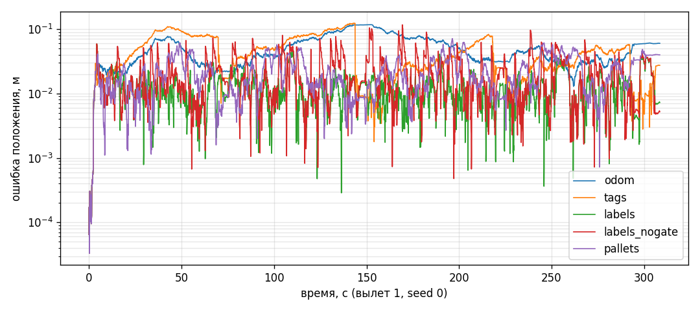

# LOC-08 (прототип): локализация по складским этикеткам — EKF

Вопрос: можно ли держать ошибку позиции дрона ≤ 10 см (KPI Ф4) без специальной инфраструктуры,
используя штатные складские этикетки с известными координатами как ориентиры?

## Метод (по Gao & Zhang, «Introduction to Visual SLAM»)

- **EKF, гл. 8.1.3**: прогноз — ф. (8.32), усиление — (8.34), апостериорная оценка — (8.35).
  Обозначения книги: R — шум движения, Q — шум наблюдения.
- **Отсев выбросов**: в гл. 8.1.4 (п. 4) сказано, что у EKF нет механизма отсева выбросов.
  Добавлен χ²-гейтинг по расстоянию Махаланобиса (2 степени свободы, 99% → порог 9.21).
- **Метрика — ATE_trans**, гл. 3.4.2, ф. (3.45).
- Карта ориентиров берётся из плана склада, поэтому это **локализация, а не SLAM**: ориентиры не входят
  в вектор состояния, и квадратичный рост ковариации (8.1.4, п. 3) не возникает.
- Состояние 2D (x, y, ψ); высота — по дальномеру. Траектория — план `invent_core.coverage`
  демо-склада (2 прохода × 27 м, 2 вылета по ~110–120 м и ~5 мин).
- Одометрия VIO: ошибка масштаба (СКО 1%), дрейф курса (СКО 0.3°/мин), шум. **У всех сценариев
  одометрия одинаковая** (отдельный поток случайных чисел), различаются только коррекции.
- Наблюдение ориентира: положение в кадре тела (как дала бы PnP по углам этикетки, гл. 6.7),
  σ = 1 см + 2%·дальность; вероятность чтения в кадре 0.8; частота 5 Гц; обе боковые камеры, HFOV 50°.
- Ошибки карты: AprilTag — 1 см; адресная этикетка на балке — 2 см; паллетная этикетка — 8 см
  (паллета стоит в ячейке неточно). 2% наблюдений привязаны к соседней ячейке; в сценарии
  `pallets` ещё 3% паллет стоят не там, где думает WMS.

Запуск: `python research/landmark_ekf/ekf_sim.py --seeds 10 --plot` (≈40 с).

## Результаты (10 прогонов × 2 вылета)

**Типичный VIO** (масштаб 1%, курс 0.3°/мин):

| Сценарий | ATE_trans, м | Макс. ошибка, м | В конце, м | Отброшено гейтингом |
|---|---|---|---|---|
| только VIO | 0.200 ± 0.081 | 0.385 | 0.288 | — |
| + AprilTag на торцах рядов (MVP) | 0.127 ± 0.056 | 0.295 | 0.034 | 3.4% |
| **+ адресные этикетки** | **0.017 ± 0.003** | **0.059** | 0.041 | 2.5% |
| + адресные этикетки без гейтинга | 0.029 ± 0.002 | 0.122 | 0.047 | — |
| + паллетные этикетки (3% не на месте) | 0.041 ± 0.009 | 0.112 | 0.066 | 5.5% |

**Плохой VIO** (масштаб 2%, курс 1°/мин):

| Сценарий | ATE_trans, м | Макс. ошибка, м | В конце, м | Отброшено гейтингом |
|---|---|---|---|---|
| только VIO | 0.471 ± 0.271 | 1.018 | 0.909 | — |
| + AprilTag на торцах | 0.333 ± 0.282 | 0.741 | 0.328 | **26.6%** |
| **+ адресные этикетки** | **0.021 ± 0.008** | **0.082** | 0.067 | 2.5% |
| + без гейтинга | 0.032 ± 0.005 | 0.132 | 0.069 | — |
| + паллетные этикетки | 0.046 ± 0.012 | 0.128 | 0.093 | 5.5% |

## Выводы для проекта

1. **Адресные этикетки как ориентиры укладываются в KPI ≤ 10 см** даже при плохом VIO
   (максимум 5.9 / 8.2 см). Это количественное обоснование научной новизны диплома (LOC-08).
2. **Маркеры только на торцах рядов для прохода 27 м недостаточны**: в середине прохода ошибка
   доходит до 30–74 см. Для привязки к ячейке шириной 0.9 м (допуск ±45 см) это на грани.
   → Пересмотреть ADR-4: либо маркеры каждые 2–3 секции, либо переносить этикетки-ориентиры из Ф4 раньше.
3. **Гейтинг обязателен** (подтверждение п. 4 гл. 8.1.4): без него максимум ошибки вдвое хуже
   и выходит за 10 см.
4. **Ловушка редких ориентиров:** при плохом VIO фильтр становится самоуверенным и гейтинг отбрасывает
   27% **верных** наблюдений маркеров. Лечится инфляцией ковариации или адаптивным порогом;
   плотные ориентиры этой проблемы не имеют.
5. **Паллетные этикетки хуже адресных** (4–5 см против 2 см): паллеты стоят неточно, а часть — не там,
   где думает WMS. Ориентиры — адресные этикетки на балках; паллетные — только с гейтингом.
   → В генератор симуляции нужны адресные этикетки (SIM-07).

## Ограничения модели (что проверить дальше)

- 2D, без высоты и без крена/тангажа; шумы независимые гауссовы; синхронизация времени идеальна.
- Точность наблюдения σ = 1 см + 2%·дальность — **гипотеза**. Проверить на фото с телефона
  (LEARN-07, `invent_core label-pose`) и на стенде (PER-03).
- Модель дрейфа VIO упрощена. Сверить с реальным OpenVINS на записи из прохода (LOC-03).
- Привязка «чтение → адрес» задана вероятностью ошибки. В реальности адрес берётся из
  содержимого адресной этикетки, поэтому ошибки привязки редки, зато возможны пропуски чтения.
- Следующий шаг — граф поз со скользящим окном (гл. 9) вместо EKF и сравнение на тех же данных.

## Фильтр или оптимизация? (гл. 8.1.4 против гл. 9) — эксперимент 28.09.2026

Книга (8.1.4) приводит доводы за оптимизацию: она заново линеаризует задачу на каждой итерации,
использует больше истории и лучше переносит выбросы (робастные ядра, 8.2.6). Проверено на тех же данных:
`window_smoother.py` — окно из 25 ключевых кадров (5 с), 3 итерации Гаусса–Ньютона, маргинализация
старого кадра через дополнение Шура (9.1.2). Запуск: `python research/landmark_ekf/ekf_sim.py --seeds 2 --window`.
Одометрия и наблюдения у всех оценщиков одинаковые (общие потоки случайных чисел). 2 прогона × 2 вылета.

| Оценщик | Адресные этикетки: ATE / макс., м | Паллетные (3% не на месте): ATE / макс., м | «Плохой VIO», адресные: ATE / макс., м | CPU на вылет, с |
|---|---|---|---|---|
| EKF + порог χ² | 0.016 / 0.054 | 0.044 / 0.126 | 0.019 / 0.073 | 0.2–0.3 |
| Окно + Хьюбер + порог χ² | 0.016 / 0.054 | 0.044 / 0.126 | 0.019 / 0.073 | 16–19 |
| Окно + только Хьюбер (как в 8.2.6) | — | 0.054 / 0.190 | — | 16 |

**Выводы:**
1. В нашей задаче — **карта известна, ориентиры плотные, модель почти линейна** — оптимизация в окне
   не даёт выигрыша по точности, а вычислений требует в 60–70 раз больше. Доводы 8.1.4 относятся к SLAM
   с неизвестными ориентирами и сильной нелинейностью; у нас их нет. → Для бортовой локализации
   оставляем EKF (`core/invent_core/localization.py`). Это аргументированное решение для главы 3 ВКР.
2. **Ядра Хьюбера мало против постоянных выбросов** (паллета стоит не там, где думает WMS, и её видят
   много раз подряд): ядро ограничивает влияние, но не обнуляет его — макс. ошибка 19 см против 12.6.
   Нужен жёсткий порог χ² (или стоит вообще не брать паллетные этикетки в ориентиры).
3. При редких ориентирах (метки только на торцах) порог в окне отбрасывает ещё больше верных наблюдений
   (37%), чем в EKF: невязка сравнивается только с шумом измерения, без неопределённости позы. Это та же
   «ловушка редких ориентиров» (LOC-12).
